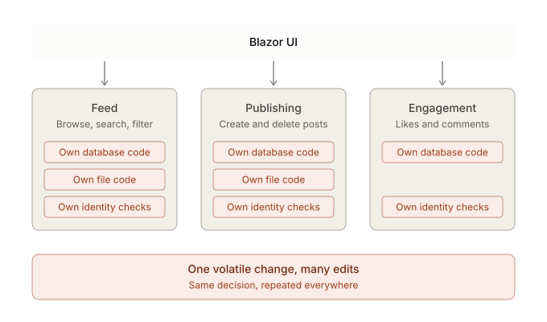
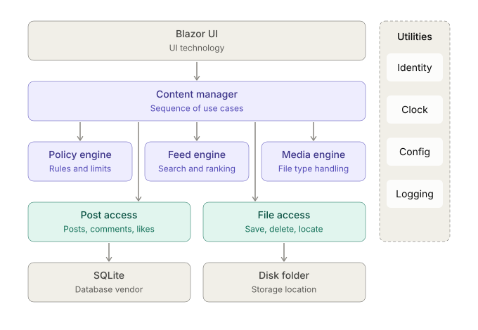

**What changed**

Here are both views of KnowledgeGram, starting with the functional one.

First, the functional view, where components are named after what the app does:

The the volatilities view:

Here each box exists to hide one thing likely to change, and the subtitles name it.

Calls only go downward, with one exception: engines never call resource access directly, so the manager is the only place that sequences them.
The utilities column on the right can be used from any layer.
It maps straight onto your Step 1 interfaces:

| Step 1 abstraction | Home in this design |
|---|---|
| `IPostRepository` | Post access |
| `IFileStorage` | File access |
| `IContentKindResolver` | Media engine |
| `ISubjectCatalog` | Policy engine (or config) |
| `IUserSession`, `IClock` | Utilities |

So the abstractions aren't thrown away. They get organized, and the page's orchestration (validate, save the file, write the post) moves out of `Home.razor` into the manager.

Here is how the same change requests land on each design:

| Change request | Functional design | Volatility-based design |
|---|---|---|
| Move files to cloud blob storage | Feed and Publishing | File access only |
| SQLite to PostgreSQL | Feed, Publishing, Engagement | Post access only |
| Real login (OAuth) | All three, plus the UI's delete button | Identity utility only |
| Reject executable uploads | Publishing | Policy engine only |
| Rank by relevance, not recency | Feed | Feed engine only |
| Add a mobile client | Rebuild or duplicate the three features | New client calling the Content manager |
| Add an approval step before publishing | Publishing, and probably Feed | Content manager only |

The functional design looks fine on day one, and its cost only shows up when requirements move. So the best demo is to build both versions from Step 1, then apply the same change requests to each and count the files touched.